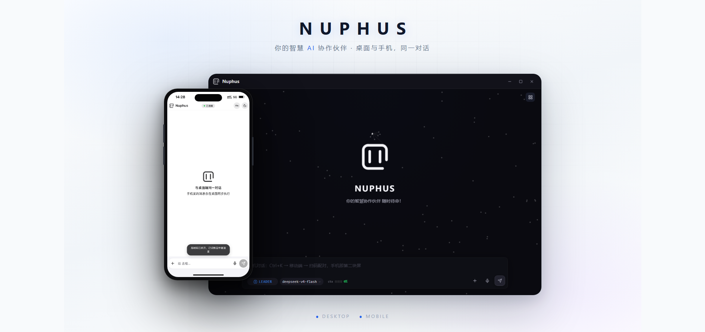
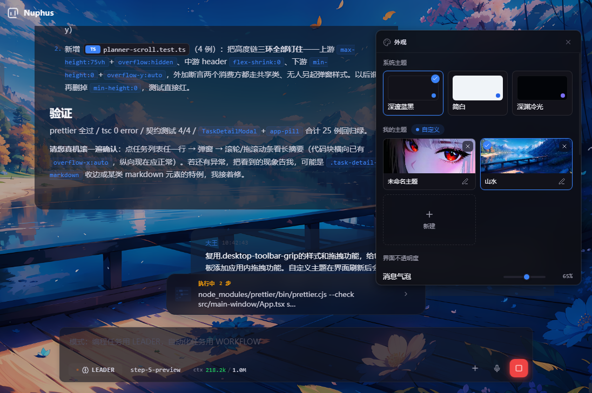
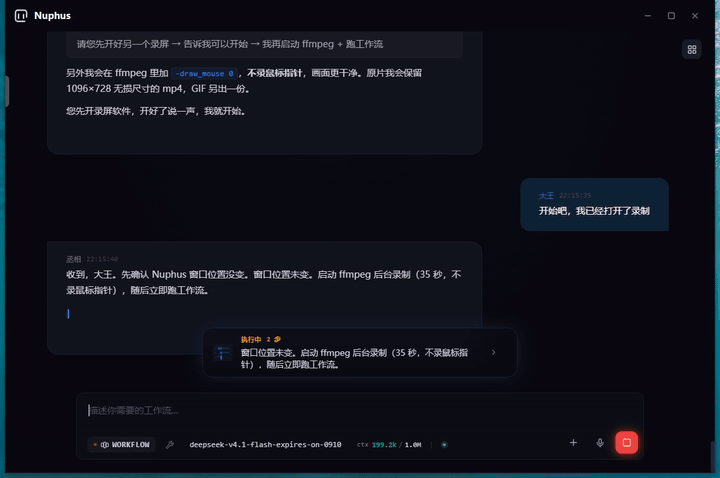

# Nuphus — 本地优先面向个人用户日常编程、办公、自动化工作流的 AI 协作伙伴

[](LICENSE)
[](https://rustup.rs/)
[](https://v2.tauri.app)
[](https://react.dev)
[](https://www.npmjs.com/package/@nuphus/nuphus-desktop) [](https://www.npmjs.com/package/@nuphus/nuphus-desktop) [](https://github.com/mrpulor-gh/nuphus/actions/workflows/main-guard.yml)

**中文** | [English](README.en.md)

> **官方网站**: [www.nuphus.com](https://www.nuphus.com) — 产品介绍、下载安装包、更新日志与使用文档

<p align="center">
  <a href="https://www.nuphus.com/download.html"></a>
  &nbsp;
  <a href="https://github.com/mrpulor-gh/nuphus/releases/latest"></a>
</p>

> **版本**: 1.5.0 · **状态**: Release（稳定版） · **平台**: Windows / macOS / Linux
> **技术栈**: Tauri v2 · Rust · React 18 · TypeScript

<p align="center">
  
</p>

**Nuphus 是完全运行在你电脑上的 AI Agent——服务本地、数据私有，拥有真实的桌面执行力，手机是同一局域网内的第二块屏幕。**

它识别屏幕、操作鼠标键盘、控制窗口、读写文件、调度浏览器，把 LLM 的推理变成真实的自动化。服务、数据和 Agent 全部运行在本机，模型连接由你自行配置。手机默认通过无线局域网连接桌面，在本地网络内同步同一份记忆、同一个 Agent 和同一场对话。

---

## 设计哲学

不在乎华丽的炫技，只在乎实用的能力。极简实用主义，功能按需呈现，拒绝堆砌套壳、重复探索和无意义消耗，主张一切落到日常工作中。

### Leader：串行思考，并行执行

Nuphus 的核心引擎用 Rust 构建，工具调用在毫秒级完成，延迟瓶颈在模型推理而非引擎。Agent 决策本身就是因果链——每一步依赖上一步的结果，桌面系统操作更应遵循串行逻辑。

- **全局理解，掌控任务** — Leader 解析目标、规划路径、监督进度、汇总交付
- **内部编排（串行）** — 调度内置 GoalType ExecAgent（项目分析 / 代码生成 / 调试诊断 / 文件操作等）按因果链逐步执行
- **外部调度（并行）** — 通过显式交互指令，同时打开 Cline 修 bug、Claude Code 写测试、浏览器查文档——每个外部 Agent 拥有自己的上下文理解，Nuphus 在之上截图验证、阅读产出、汇总决策
- **上下文传递** — 显式指令让外部 Agent 拥有任务上下文，减少重复指令和探索

**串行的是思考，并行的是执行。**

<p align="center">
  
</p>

### Workflow：把一次探索固化为确定性执行

LLM 每次用 token 解决 85% 相同的任务，是对算力和时间的双重浪费。Nuphus 的解法——**让 LLM 推理一次，编译为工作流，之后极低 token 重复执行**：

```
自然语言交互 → Agent 共同探索（理解界面/流程/参数） → 逐步固化参数 → 编译为确定性执行序列 → 引擎重复执行
```

这不是定时任务，而是**把一次有智慧的探索，固化为可重复的确定性执行**：

- **自然语言探索** — 用自然语言与 Agent 交互，批阅试卷、浏览器自动化、桌面软件操作……Agent 理解意图、识别界面、逐帧操作
- **参数固化** — 共同探索后，把每一步的定位、操作、异常处理固化为参数（参数即契约，全部有界面证据）
- **确定性执行** — 编译后的执行序列极低 token 重复执行，不再依赖 LLM 每次重新推理
- **值守修复** — 运行时 Agent 负责值守：发现错误时，根据设计意图和目标自动修复、记录、优化，而非盲目重试

一次编译的投入，换来**确定性、可重复、极低边际成本**的自动化。

<p align="center">
  
</p>

> 上面这段 GIF 是一次编译好的工作流在重复执行：`Ctrl+K` 命令面板搜索定位 → 依次打开/关闭 11 个设置面板（约 25 秒），全程零 LLM 推理。

---

## 核心亮点

### 真实桌面执行力

Nuphus 直接安装在你的操作系统上，拥有原生级的屏幕感知和输入控制能力：

- **操控任意 GUI** — 窗口 + OCR + 键鼠，任何桌面软件/网页都能自动化，无需对方提供 API
- **内置浏览器** — 可编程的浏览器内核，网页自动化、信息采集、表单交互都在本机完成
- **编程与项目分析** — 项目分析、代码生成、调试诊断、文件操作，深度理解项目上下文
- **多 Agent 调度** — 并行调度 Cline、Claude Code 等外部 Agent，统一汇总决策

### 双端实时同步：桌面干活，手机掌控

Nuphus 把「执行」和「掌控」分开：**桌面是 Agent 的双手，手机是你的遥控器。**

- **同一会话，双端同步** — 手机连接的正是桌面那个 Agent：发消息走同一个会话入口，桌面和手机共享历史、记忆与状态
- **实时事件流** — Agent 的每一步（思考、工具调用、执行结果）通过 WebSocket 实时推送到手机
- **工作流遥控** — 手机上直接暂停、恢复、停止正在执行的工作流
- **执行轨迹回放** — 手机上查看 Agent 的完整执行轨迹，每一步都透明可查
- **无线局域网直连** — 手机与电脑在同一 Wi-Fi 下直接访问本机服务，不经过官方服务器
- **服务端由你掌握** — Nuphus 不提供官方中继；需要异地访问时，可自行部署并配置 `relay-server`

本地网络内手机直接连接桌面；P2P 与自定义服务端均为用户可控的可选能力。

### 本地优先，隐私自有

- **数据留在本机** — 对话、记忆、插件全部存储本地
- **本地 AI 引擎** — PP-OCRv4（OCR）、Candle（语义搜索）全部本地运行，日常识别零 API 消耗
- **4 层安全体系** — 权限开关 → 人在回路 → 注入检测 → 熔断保护
- **模型自由** — OpenAI / Anthropic / DeepSeek / Qwen / 智谱等主流厂商统一接入，随时切换

### 内置工具页：PDF / 图像 / 视频 / 音频 / 文档

无需安装任何外部工具，工具页内置 23 个处理命令：

| 分类 | 能力 |
|------|------|
| PDF | 合并 / 压缩 / 文本提取 / 图片转 PDF / 抽页 / 旋转 |
| 图像 | 压缩 / 格式转换 / 缩放 / 拼接 / 批量压缩 / 批量转换 |
| 视频 | 压缩 / 抽帧 / 转 GIF / 截取片段 |
| 音频 | 提取音频 / 音频转换 / **语音克隆**（走云端） |
| 文档 | docx / pptx / xls / pdf 等转文本 |

### 更多能力

| 能力 | 说明 |
|------|------|
| **记忆系统** | 跨会话经验积累，SQLite 持久化 + FTS5 + 向量语义检索，越用越懂你 |
| **零编译扩展** | 知识库、技能、工作流、ui-maps 均为纯文本文件，放入 `plugin/` 即生效 |
| **视觉感知三层** | 内置 OCR（零 API 消耗）→ 可配置视觉模型（复杂场景）→ 用户视觉引导（最灵活 fallback） |
| **确定性工作流** | 常用任务编译为工作流，零 token 重复执行（见上文设计哲学） |
| **音效反馈** | 任务完成 / 错误 / 重试均有音效提示，不盯屏也能感知状态 |

---

## 安装

### npm 一键安装（推荐）

一条命令完成安装，自动匹配当前平台的二进制（Windows x64 / macOS arm64 / Linux x64），**无需下载安装包、无需 Node.js / Rust 环境**：

```bash
# 全局安装（提供 nuphus 命令）
npm install -g @nuphus/nuphus-desktop

# 或免安装体验（不写入全局）
npx @nuphus/nuphus-desktop
```

安装完成后在终端输入 `nuphus` 即可启动。

> 首次安装体积较大（桌面应用含本地 OCR / 语音模型），请耐心等待。

### 下载安装包

面向不熟悉命令行的用户，**无需命令行、无需 Node.js / Rust 环境**：

1. 从 [官方网站](https://www.nuphus.com/download.html)（国内访问快）或 [GitHub Releases](https://github.com/mrpulor-gh/nuphus/releases) 下载对应平台的安装包：
   - **Windows**：`.exe`（NSIS 安装包，用户级安装，**无需管理员权限**）
   - **macOS**：`.dmg`
   - **Linux**：`.deb` / `.AppImage`
2. 双击安装包完成安装（Windows 安装后桌面生成 **Nuphus** 快捷方式）
3. 双击快捷方式即可启动

> **国内网络下载缓慢或失败时**，改从 [Gitee Releases](https://gitee.com/nuphus/nuphus/releases)
> 获取 Windows 安装包（与 GitHub 发布版同一文件，签名一致，可直接用于自动更新）。
> macOS / Linux 安装包暂仅托管在 GitHub，可配合镜像或代理下载。

### 从源码构建（开发者）

**前置条件：**

| 工具 | 版本 | 用途 |
|------|------|------|
| [Rust](https://rustup.rs/) | 1.95.0（`rust-toolchain.toml` 锁定） | 核心引擎编译 |
| [Node.js](https://nodejs.org/) | ≥ 20（vitest 4 不支持 18） | Tauri 前端构建与前端测试 |
| Tauri CLI | `cargo install tauri-cli --version "^2"` | 桌面应用开发 |

```bash
git clone https://github.com/mrpulor-gh/nuphus.git
cd nuphus

# 安装依赖（根目录 Tauri CLI + 前端依赖）
npm install

# 开发模式启动
npx tauri dev
```

构建产物会持续增长，开发一段时间后可清理构建缓存释放磁盘（下次构建会重新编译）：

```bash
cargo clean
```

---

## 快速开始

### 配置模型

1. 首次启动进入引导页，选择模型提供商并填入 API Key
2. 按 Enter 提交即完成配置

> 也支持环境变量免配置启动：`QWEN_API_KEY="sk-xxx" npx tauri dev`

> 引导完成后可在「设置 → 模型」面板修改配置。API Key 加密存储：Windows 上经系统级 DPAPI 加密后写入本地 config.toml（`enc:v1:` 格式，绑定当前用户）；macOS/Linux 暂以明文保存（依赖系统文件权限，OS 凭据链接入在路线图中）。请勿分享或提交该文件。

### 使用 ChatGPT 套餐（预览）

在「设置 → 模型 → ChatGPT」点击 **Continue with ChatGPT**，在系统浏览器完成账号授权，即可用套餐额度驱动 Agent。可添加多个账号/工作区；支持图片的模型可在卡片上单独开启视觉输入。

- **计费** — 走 ChatGPT 套餐的共享用量，与 API Key 连接独立；接口失败时不会自动回落到 API 计费。可用模型与额度以官方接口为准。
- **能力** — 复用 Nuphus 自身的 Agent Runtime 与函数工具，支持模型具备的图片输入；不依赖 Codex CLI，也不读取其他应用的登录凭据。音频与图像生成仍走各自连接。
- **安全** — 授权回调只监听 `127.0.0.1`，校验 PKCE 与 ID-token；凭据单独保存在本地配置目录的 `chatgpt-accounts.json`（Windows 经 DPAPI 加密，Unix 为 `0600`），**请勿分享或提交该文件**。
- **预览** — 官方预览接口的模型、配额与可用性可能调整，不作为稳定服务承诺。详见[开源应用接入](https://developers.openai.com/siwc/token-sharing-open-source)与[预览限制](https://developers.openai.com/siwc/token-sharing-open-source/preview-limitations)。

### 连接手机

1. 确保手机与电脑连接同一个无线局域网
2. 在桌面端「手机」设置页开启本地移动端服务（默认端口 18772）
3. 手机扫描局域网配对码，或打开局域网地址输入配对密码
4. 添加到主屏幕（PWA），以后像 App 一样使用

默认只使用无线局域网连接。手机配对页或“网络与连接”中可切换服务端地址；异地访问需要自行部署并配置服务端。

---

## 架构概览

Nuphus 采用六层架构，自底向上，安全贯穿各层：

```
┌─────────────────────────────────────────────┐
│ Tauri 壳                                    │  ← 前端 UI + 系统级能力（通知、托盘、快捷键）
├─────────────────────────────────────────────┤
│ Runtime                                     │  ← 统一主循环，三模式路由（Leader / Workflow / Custom）
├─────────────────────────────────────────────┤
│ Agent                                       │  ← Leader 决策 / ExecAgent 执行 / WorkflowAgent 设计
├─────────────────────────────────────────────┤
│ Transport                                   │  ← 多 Provider 抽象层（主流 AI 厂商统一接入）
├─────────────────────────────────────────────┤
│ Tools / Memory / Workflow                   │  ← 执行基础设施
├─────────────────────────────────────────────┤
│ Security / Permissions                      │  ← 贯穿所有层的安全链（注入检测 / 权限分级 / 审核）
└─────────────────────────────────────────────┘
```

**双端同步架构**：

```
┌──────────┐   WebSocket 实时事件流    ┌──────────────┐
│  手机 PWA │ ←──────────────────────→ │ 桌面 mobile  │
│ (聊天/遥控)│   POST /message 共享入口   │  server(18772)│
└──────────┘                          └──────┬───────┘
      ↕ 无线局域网直连（默认）                  │ 共享会话/记忆/状态
┌──────────────┐                        ┌──────┴───────┐
│ 可选：自建服务端 │ ←── 用户显式配置 ──→ │  Nuphus 桌面  │
│ (非官方服务)   │                        │  Agent 引擎   │
└──────────────┘                        └──────────────┘
```

手机端发消息走 `submit_user_message(source="mobile")`，与桌面共用同一 `leader_agent` / busy 锁 / 去重逻辑——双端是**同一个 Agent 的两个界面**，不是两个独立系统。断线自动指数退避重连，重连成功后重拉历史补齐间隙，不会丢消息。

**数据流**：用户输入 → Tauri 事件 → Runtime 路由 → Leader 决策 → `task_dispatch` → ExecAgent 执行 → 结果返回 → 前端展示（桌面与手机同步）

---

## 配置

Nuphus 使用 TOML 配置文件，`src/config/mod.rs::load_registry` 按优先级搜索：

| 序号 | 路径 | 适用 |
|---|---|---|
| 1 | `<exe_dir>/config.toml` | 绿色版 / 便携部署 |
| 2 | `./config.toml` | 开发 |
| 3 | `~/.config/nuphus/config.toml` | Linux/macOS 用户级 |
| 4 | `~/.nuphus/config.toml` | 兼容旧版 |
| 5 | `<AppData>/nuphus/providers.toml` | Windows 桌面版规范配置（桌面端锚定，首次启动自动生成） |

---

## 设计原则

1. **本地优先** — 数据默认留本机，云端只在用户选择时介入
2. **极简心智** — 每个功能都尽量简单，避免过度抽象
3. **确定性优先** — 能编译为工作流就不反复推理，能复用就不重写
4. **Long-Term First** — 优先选择与现有架构一致、可维护的方案
5. **克制优于堆叠** — 每个新功能必须证明自己不可替代
6. **闭环设计** — 每个功能模块从输入到产出形成完整闭环

---

## 如何贡献

Nuphus 是一个社区驱动的开源项目。除了代码贡献，你还可以通过以下方式参与生态建设：

### 贡献插件（后续开放）

| 插件类型 | 说明 | 示例 |
|---------|------|------|
| **ui-maps** | 任何软件的界面布局描述（按钮位置、窗口识别特征） | Photoshop 导出面板、企业 ERP 系统布局 |
| **workflows** | 可复用的工作流模板 | "每日备份项目文件夹"、"批量图片压缩" |
| **skills** | 领域方法论和操作指南 | "前端 UI 设计规范"、"特定框架的代码模式" |
| **knowledge** | 项目领域知识文档 | API 参考、配置说明、架构文档 |

所有插件均为纯文本文件（.md / .json），放入 `plugin/` 对应目录即可被 Nuphus 加载。

### 参与讨论

- GitHub Issues：Bug 报告和功能请求
- GitHub Discussions：使用问题、经验分享、插件推荐

---

## 致谢

感谢每一位让 Nuphus 变得更好的人。头像取自 GitHub，点击直达主页：

<p align="center">
  <a href="https://github.com/yuansui486"></a>
  <a href="https://github.com/Steooenwolf-666"></a>
  <a href="https://github.com/fouyzjl"></a>
  <a href="https://github.com/zhoupeiyu515-ui"></a>
  <a href="https://github.com/ZYT-ZhangYunTao19941116"></a>
  <a href="https://github.com/jiangdingwei123-afk"></a>
  <a href="https://github.com/mrpulor-gh"></a>
</p>

### 最新版本 · v1.5.0（2026-11-16）

| 贡献者 | 提交 | 内容 |
|--------|------|------|
| [@mrpulor-gh](https://github.com/mrpulor-gh) | [`0a618938`](https://github.com/mrpulor-gh/nuphus/commit/0a618938) | 移动端支持推理强度选择：模型子页按服务商展示并保存 reasoning effort，后端模型投影与写入口与桌面端共用 |
| [@mrpulor-gh](https://github.com/mrpulor-gh) | [`3dd837b3`](https://github.com/mrpulor-gh/nuphus/commit/3dd837b3) | 移动端导航重构为底部 Tab（聊天 / 会话 / 设置），品牌区恢复纯展示，右侧抽屉与右滑关闭手势移除 |
| [@mrpulor-gh](https://github.com/mrpulor-gh) | [`363955b6`](https://github.com/mrpulor-gh/nuphus/commit/363955b6) | 移动端会话列表对齐桌面会话工作台：单行版式、模式单字母方块、行尾相对时间与当前徽标 |
| [@mrpulor-gh](https://github.com/mrpulor-gh) | [`e05885ce`](https://github.com/mrpulor-gh/nuphus/commit/e05885ce) | 修复移动端重开丢失执行过程：历史不再清空执行轨迹，并归一化后端 `trace_items` 字段名 |
| [@mrpulor-gh](https://github.com/mrpulor-gh) | [`0ba437c3`](https://github.com/mrpulor-gh/nuphus/commit/0ba437c3) | 移动端执行中重连恢复当前轮：后端在事件出口累积快照，`/agent-status` 下发 `liveTurn` 供流式气泡续写 |
| [@mrpulor-gh](https://github.com/mrpulor-gh) | [`ca27c1dd`](https://github.com/mrpulor-gh/nuphus/commit/ca27c1dd) | 移动端首 token 等待指示：一行不占消息身份的等待提示，气泡创建后自动消失 |

每次发版只保留最近一版的贡献，旧版内容由新版本替换；更早的记录见 [CHANGELOG.md](CHANGELOG.md) 与「设置 → GitHub 贡献者」页。

## 许可

Copyright © 2026 Nuphus Team · Apache License 2.0
